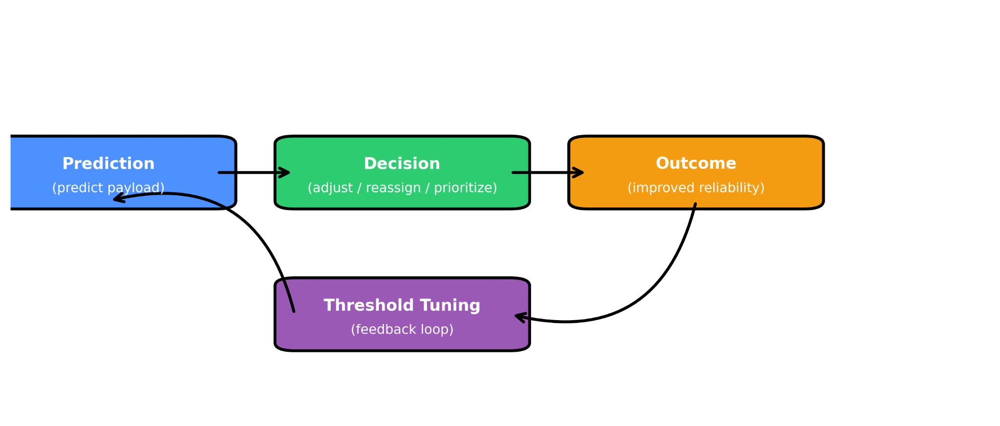
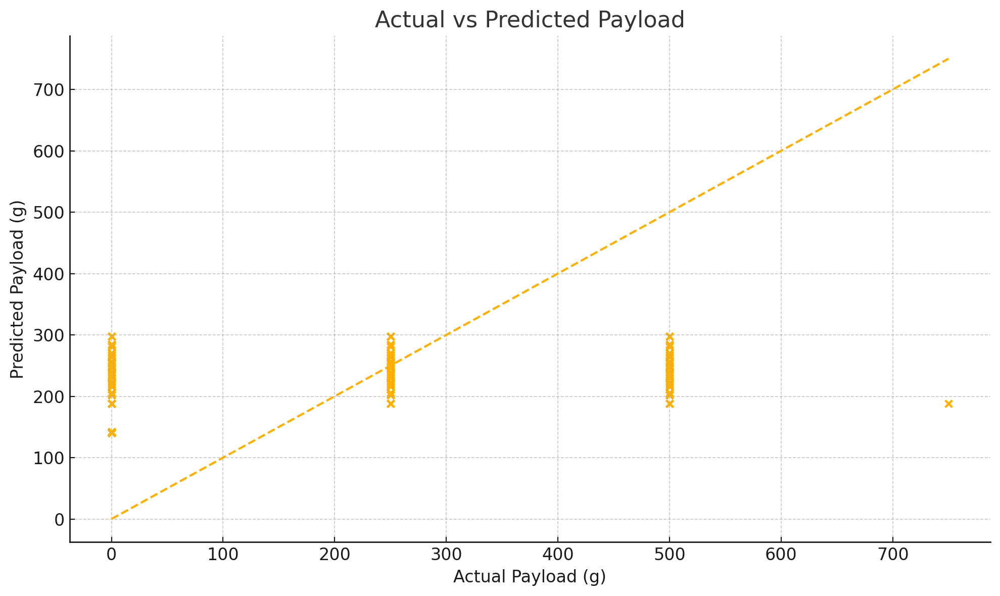

# Drone Delivery Decision Engine

**Python · Scikit-learn · Pandas · Matplotlib · Regression · Model Evaluation**

A research prototype that explores whether lightweight flight telemetry can predict a drone's payload and generate **candidate heavy-load review flags** for delivery operations. Developed as a group research project at NC State's Global Training Initiative.



## Problem and approach

Drone dispatch systems need to account for payload capacity before committing to a delivery. Our research asked whether basic telemetry could estimate the payload of a flight: **speed and altitude → predicted payload (grams) → threshold-based review flag**. The original presentation discussed adjusting a load, reassigning a drone, or delaying a shipment as *potential* operational responses; it did not demonstrate a deployed autonomous dispatch service.

## Research findings

The original slides report a **weak baseline**: R² around **0.031–0.040**, with a holdout MSE of approximately **48,279 g²** in one experiment. This means the available predictors explain only about **3–4% of observed payload variation**, and **reliable capacity classification was not demonstrated**. A 90th-percentile alert around **281 g** appeared in the presentation as an exploratory example—not a validated safety threshold.

The slides describe an empirical **209-flight quadcopter dataset** with controlled payload levels (0/250/500 g) and varying speeds and altitudes. The presentation and different notebook cells use somewhat different feature selections and modeling approaches; this repository makes the simplified **speed + altitude** baseline explicit.



## Repository structure

```text
src/drone_delivery/    Reusable preprocessing, training, prediction and plotting
notebooks/             Original Google Colab exploration
assets/                Original project charts and flow diagram
tests/                 Unit tests for regression and threshold behavior
data/                  Instructions for obtaining the missing source CSV
```

## Run locally

```bash
python -m pip install -e ".[dev]"
python -m drone_delivery.cli data/parameters.csv --out results
pytest -q
```

Expected CSV column names: `speed`, `altitude`, `payload`. The code converts values to numeric, drops missing target values, splits before fitting the mean imputer, fits linear regression, saves test predictions, and generates plots and metrics. **The dataset itself was not among the recovered files**, so published figures are shown for context; the reported experimental metrics cannot be independently reproduced from the current repository alone.

## Decision logic

The new, explicitly labeled **refactored baseline** computes the alert cutoff from the 90th percentile of **training predictions** to avoid selecting it using held-out outcomes. A prediction higher than that cutoff receives `heavy_flag=True`. The flag is a *triage signal*, **not** verified evidence of overload, a drone capacity limit, or a production dispatch decision.

## Original work vs. reconstructed code

- **Recovered from original:** Colab exploration of descriptive statistics, correlations, missing-data imputation, train/test regression and OLS; original presentation charts and conceptual feedback-loop diagram.
- **New software packaging:** reusable Python modules, a command-line workflow, automated tests, leakage-safe preprocessing, saved results, and reproducible plots.
- **Not recovered:** the original `parameters.csv`, trained model artifacts, live drone telemetry, evidence of a deployed scheduler, and the raw observations underlying the presentation figures.

## Next steps

Add verified source data and citation, validate with flight-grouped splits, compare to a constant-mean predictor, incorporate battery/wind/weather variables, calibrate alert rules against actual capacity constraints, and measure false-positive/false-negative rates before any operational use.

## Acknowledgments

Group research credited to **Ansh Khungar, Rina He, Alan Liu, Benjamin Durham, Sean Huang, and Aayush Bhasuru (Group D)**, as listed on the original presentations. The research presentation attributes flight data to a publicly available CMU quadcopter dataset; an exact source citation still needs verification.

*Research demonstration only. Not for safety-critical or real-world flight operations.*
